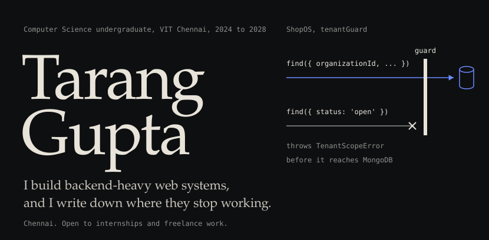
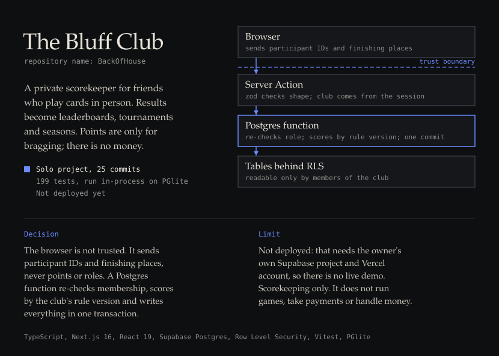
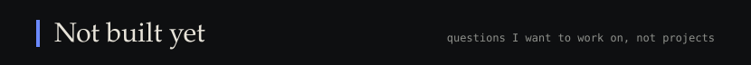
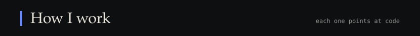

Source: [tarang802/ShopOS](https://github.com/tarang802/ShopOS). No hosted demo; its README covers running it locally with Docker.

Source: [tarang802/BackOfHouse](https://github.com/tarang802/BackOfHouse). Not deployed, so there is no live demo.

Source: [tarang802/SoundVerse-BeatAgent](https://github.com/tarang802/SoundVerse-BeatAgent). Its [DECISIONS.md](https://github.com/tarang802/SoundVerse-BeatAgent/blob/master/DECISIONS.md) records what I considered, what I picked, and what would make me revisit it.

| Project | What it is | Status |
|---|---|---|
| [inboxiq](https://github.com/tarang802/inboxiq) | Inbox cleanup service that finds subscription senders through the Gmail API, behind Google sign-in. React and Vite, Express, Prisma, PostgreSQL. | In development. Its README still lists the architecture as coming soon, and Redis, BullMQ and billing as future work. |
| [AI_Hub](https://github.com/tarang802/AI_Hub) | Members-only AI/ML wiki for the Microsoft Innovations Club: Google sign-in, three roles, pages stored in MongoDB. A fork where 28 of 39 commits are mine; [my pull request](https://github.com/Anasarfeen123/AI_Hub/pull/2) adding admin page management and error-handling fixes was merged upstream. | Its README lists it as deployed on [Render](https://mic-ai-ml-resource-hub.onrender.com). |
| [Technovit Recursion](https://github.com/tarang802/Technovit-Recursion-) | Site for RECURSION II, the club's 24-hour hackathon. React, TypeScript and Vite. | [Live](https://technovit-recursion.vercel.app). |
| [Google-sheets-reviewer](https://github.com/tarang802/Google-sheets-reviewer) | Reads hackathon ideas from a Google Sheet, shows them as cards, and writes accept or reject back with the reviewer's name and a timestamp. Express, React, JWT, one Vercel project. | Small tool, 5 commits. [Live](https://google-sheets-reviewer.vercel.app). |
| [Bluff Night](https://github.com/tarang802/Bluff) | Score keeper for a card night that runs entirely in the browser. Scores are derived from a log of rounds, so undo just removes the last round. React and Vite, installable as a PWA. | Working app, 11 commits. Scores stay on one device. [Live](https://bluff-dun.vercel.app). |

| Where | What I did | Code |
|---|---|---|
| Beyawned, freelance full-stack developer | A resume and career platform. A 53-endpoint Node.js and Prisma REST API on a 17-model PostgreSQL schema. ATS document scoring and job-description matching. Google OAuth, OTP and JWT sign-in. Razorpay payments with signature-verified webhooks. Live order status over Server-Sent Events, with retry handling and scheduled cleanup. | Private client code |
| SS Real Estate, freelance web developer | A CMS in PHP and MariaDB: property search, prepared statements, Gemini Flash-powered admin endpoints, and MySQL transactions with rollback. | Private client code |
| Microsoft Innovations Club, VIT Chennai | Projects Head and Board Member. The club website, a recruitment platform, workshop and event infrastructure, technical workshops and student projects. | Public examples: Technovit Recursion, AI_Hub |
| Newton School of Coding Club | Joint Secretary. | |

None of these exist as projects. The right column is the closest thing I have actually built.

| Question | Nearest thing I have built |
|---|---|
| How does a workflow step retry without applying twice? | ShopOS runs an hourly overdue sweep. Beyawned's payment webhooks have retry handling (client work). |
| What decides which model gets a request, and what happens when it fails? | BeatAgent calls one provider, Gemini, behind a validated plan. Nothing routes yet. |
| How do you know a retrieval change made answers better? | BeatAgent has an eval harness that measures beat accuracy with mir_eval. The habit of measuring, not retrieval itself. |
| What should an agent be allowed to do between its plan and its effect? | BeatAgent validates a model's plan before it edits anything. |
| What breaks first when work moves from a request into a queue? | inboxiq lists Redis and BullMQ as planned. Nothing built. |
| What would I need to see to debug this without reproducing it? | ShopOS logs with Pino and has a health module. |

- Email: [taranggupta2802@gmail.com](mailto:taranggupta2802@gmail.com)
- LinkedIn: [tarang-gupta](https://www.linkedin.com/in/tarang-gupta-9b7b27322/)
- X: [@tarangg802](https://twitter.com/tarangg802)
- GitHub: [tarang802](https://github.com/tarang802)
