## Tarang Gupta

Computer Science undergraduate at VIT Chennai (2024–2028). I build backend-heavy web systems, and I write down where they stop working.

## Projects

### Systems and products

- **[ShopOS](https://github.com/tarang802/ShopOS)** 
  Multi-tenant SaaS for wholesale and retail businesses: product pricing, branches and staff operations in one place. 
  `Node.js · Express · TypeScript · MongoDB · React` · [Source](https://github.com/tarang802/ShopOS)

- **[The Bluff Club](https://github.com/tarang802/BackOfHouse)** 
  A private club app for friends who play cards in person. Record results; leaderboards, tournaments and seasons follow. The repository is called BackOfHouse. 
  `Next.js · TypeScript · Supabase · PostgreSQL · Tailwind CSS` · [Source](https://github.com/tarang802/BackOfHouse)

- **[SoundVerse BeatAgent](https://github.com/tarang802/SoundVerse-BeatAgent)** 
  A chat agent for audio: beat tracking, two-track sync and beat-grid editing from typed requests. 
  `Python · FastAPI · React · Gemini · Beat This!` · [Source](https://github.com/tarang802/SoundVerse-BeatAgent)

- **[inboxiq](https://github.com/tarang802/inboxiq)** 
  Privacy-first inbox cleanup that finds unwanted email subscriptions and helps you unsubscribe. In development. 
  `React · Vite · Express · Prisma · PostgreSQL · Gmail API` · [Source](https://github.com/tarang802/inboxiq)

### Club work and small tools

- **[AI_Hub](https://github.com/tarang802/AI_Hub)** 
  Members-only AI/ML learning hub for the Microsoft Innovations Club. A fork: 28 of its 39 commits are mine, and [my pull request](https://github.com/Anasarfeen123/AI_Hub/pull/2) was merged upstream. 
  `React · Express · MongoDB` · [Source](https://github.com/tarang802/AI_Hub) · [Live](https://mic-ai-ml-resource-hub.onrender.com)

- **[Technovit Recursion](https://github.com/tarang802/Technovit-Recursion-)** 
  Website for RECURSION II, the club's 24-hour hackathon. 
  `React · TypeScript · Vite` · [Source](https://github.com/tarang802/Technovit-Recursion-) · [Live](https://technovit-recursion.vercel.app)

- **[Google-sheets-reviewer](https://github.com/tarang802/Google-sheets-reviewer)** 
  Reads hackathon ideas from a Google Sheet and lets reviewers accept or reject each one. 
  `Express · React · JWT` · [Source](https://github.com/tarang802/Google-sheets-reviewer) · [Live](https://google-sheets-reviewer.vercel.app)

- **[Bluff Night](https://github.com/tarang802/Bluff)** 
  A score keeper for a card night that runs entirely in the browser and installs as a PWA. 
  `React · Vite · Tailwind CSS` · [Source](https://github.com/tarang802/Bluff) · [Live](https://bluff-dun.vercel.app)

## Stack

- **Languages** TypeScript, JavaScript, Python, SQL, PHP
- **Frontend** React, Next.js, Vite, Tailwind CSS
- **Backend** Node.js, Express, FastAPI, REST APIs, JWT
- **Data** PostgreSQL, Supabase, MongoDB, Prisma, MySQL
- **Testing** Vitest, React Testing Library, PGlite
- **Delivery** Docker, GitHub Actions, nginx, Vercel, Render
- **Learning** Distributed systems, observability, retrieval and search, Redis and BullMQ

## Experience

- **Beyawned**, freelance full-stack developer. A resume and career platform: a Node.js and Prisma REST API on PostgreSQL, Google OAuth, OTP and JWT sign-in, and Razorpay payments with signature-verified webhooks. Private client code.
- **SS Real Estate**, freelance web developer. A CMS in PHP and MariaDB with property search and Gemini Flash-powered admin endpoints. Private client code.
- **Microsoft Innovations Club, VIT Chennai**, Projects Head and Board Member. The club website, a recruitment platform, workshops and student projects.
- **Newton School of Coding Club**, Joint Secretary.

## Contact

[taranggupta2802@gmail.com](mailto:taranggupta2802@gmail.com) · [LinkedIn](https://www.linkedin.com/in/tarang-gupta-9b7b27322/) · [X @tarangg802](https://twitter.com/tarangg802) · [GitHub](https://github.com/tarang802)
